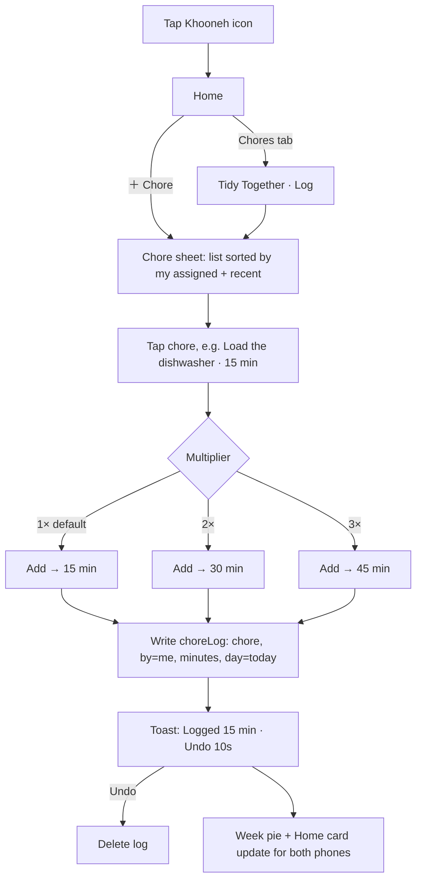
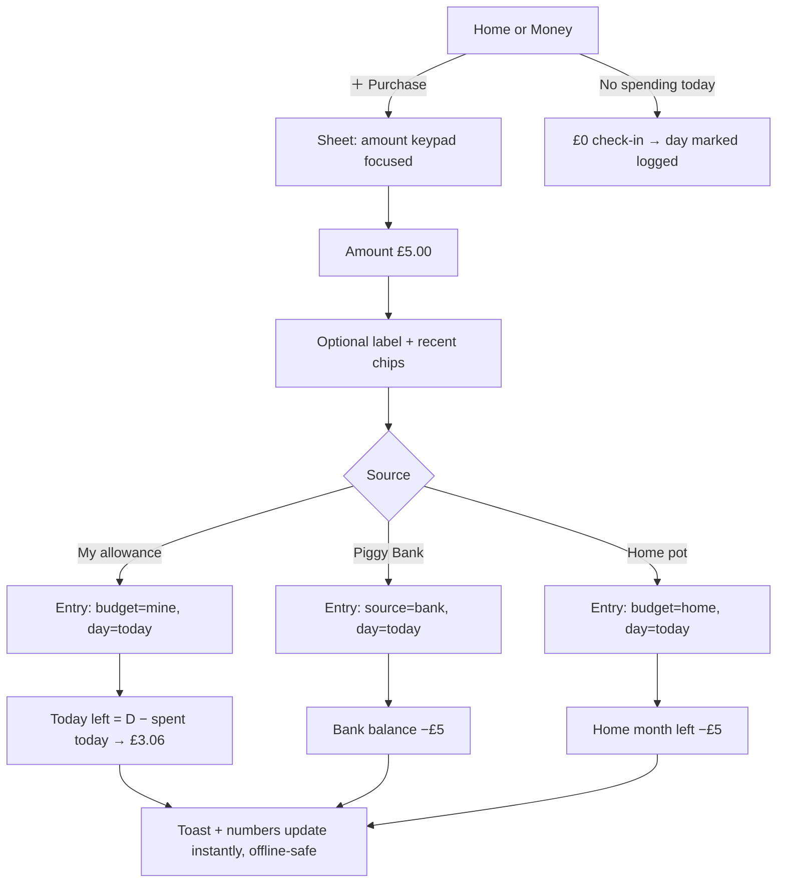
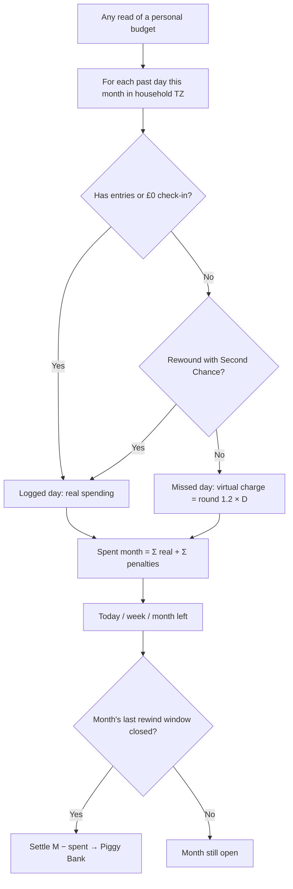
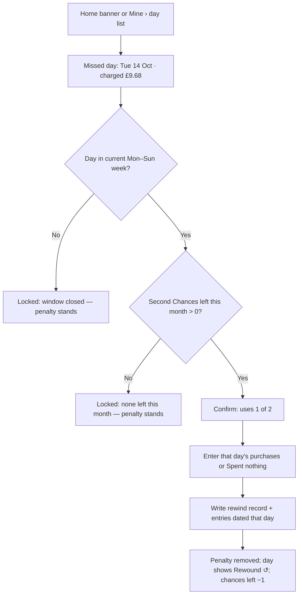

# Khooneh — Family Command Center · Product Design Document

Date: 2026-10-16 · Status: draft for review · Owner: Iman (admin) · Users: Iman & Tahereh
Builds on: `2026-10-09-responsible-2gether-design.md` (the live chores app at 2gether.imansaraei.com)

---

## 1. Summary

Today Iman and Tahereh would need one app for chores and another for money. Two apps means two
icons to find, two habits to keep, and twice the forgetting. **Khooneh** (خونه, "home") folds both
into one Home Screen icon that opens on a dashboard of modules:

| Module | Cute name | What it does |
|---|---|---|
| Chores | **Tidy Together** 🧺 (formerly *Responsible 2gether*) | Log chores as time blocks (+1×, +2×); see who did what this week; give each other feedback |
| Money | **Pocket Money** 👛 | Personal monthly allowances broken into "today / this week / this month", with fast purchase entry |
| Savings | **Piggy Bank** 🐷 (inside Pocket Money) | Whatever is left at month end lands here, to spend whenever, on anything |

The money module carries the behaviour-design core: **log every day, or the app assumes you
overspent**. A missed day is charged at 120% of the daily allowance. A **Second Chance** lets you
replace that charge with your real spending, but only twice a month and only until that week ends.

An **admin web panel** at a separate address lets Iman change names, allowances, chores and rules.

Alternative names, if "Khooneh" doesn't land: *Our Nest* · *Lanah* (لانه, nest) · *Two of Us*.
The module names (Tidy Together, Pocket Money, Piggy Bank) work with any of them.

---

## 2. Decisions and assumptions

Decided with Iman on 2026-10-16:

| # | Decision |
|---|---|
| D1 | **Platform: keep the installable web app (PWA)** at the existing origin `2gether.imansaraei.com`. It costs £0, needs no App Store, and keeps the existing Web Push reminders (10:00/22:00). The admin panel is a separate web URL. This replaces the brief's "React Native / Flutter / native" assumption. |
| D2 | **The daily penalty and Second Chances apply only to personal budgets** (Iman, Tahereh). Either partner can log to the shared **Home** budget on any day of the month, with no penalty. |
| D3 | **Chores: blocks replace percentages; feedback stays.** Each chore has a block length (e.g. dishwasher = 15 min) and an assignee. You log +1× or +2× blocks. The pie shows each person's minutes. The Feedback tab, helpfulness score and 2:1 warning are unchanged. |
| D4 | **Budgets are a flexible list**, not three fixed fields. The initial set is Tahereh £250, Iman £200, Home £100 per month. The admin can add budgets (for example the transcript's second £200 pot) and change any amount. |
| D5 | **When Second Chances run out**, a missed day keeps its 120% charge and that day stays locked until the month resets. |
| D6 | **Piggy Bank is a plain number**: no milestones and no interest. |

Assumptions (flagged so they can be overturned):

| # | Assumption | Why |
|---|---|---|
| A1 | **"Day" means the household time zone** (default `Europe/London`, set in admin). This holds even when a phone travels, e.g. to Iran. | Both people's penalty days line up and can't be dodged by changing the phone's time zone. |
| A2 | **A day counts as "logged"** if it has at least one entry for that budget: a purchase, or an explicit **"No spending today"** tap. | Without a zero-spend check-in, a frugal day would be penalised. |
| A3 | **"Cannot rewind by the end of the week"** means a missed day can be rewound only until the end of the week (Mon–Sun) that contains it, and only for past days. | This is the literal reading of the transcript. |
| A4 | **A month settles into Piggy Bank once its rewind windows have closed**, i.e. after the week containing the month's last day ends. Settlement is month allowance − month spending. | A month can't close while one of its days can still be rewound. |
| A5 | **Overspending reduces Piggy Bank**, which can go negative. There is an admin switch, *Overspend draws from bank*, which is on by default. | Without it, overspending would have no consequence, which defeats the rules. |
| A6 | **Spending from Piggy Bank** is a purchase whose source is *Bank*. It reduces the bank, not the daily allowance, and follows the same-day rule. | One entry screen covers both sources. |
| A7 | **Privacy is soft.** The shared family view shows totals only; itemised purchases appear only on the owner's own phone. Both phones share one household database, so this is a UI convention, not encryption. | It matches the no-login design. Per-person sign-in is the upgrade path if real secrecy is ever needed (§10). |
| A8 | **The admin is protected by Google sign-in** with an allowlist (Iman's account), enforced in the security rules. Cloudflare Access email OTP is an optional extra layer, and also free. | The mobile app has no logins, so admin rights can't come from the household code. |
| A9 | **Money is stored in pence (integers)**, in a single currency (GBP), formatted `£8.06`. | Avoids floating-point drift. |
| A10 | **Allowance changes take effect next month** by default, with an admin option to apply one to the current month. | Mid-month changes would rewrite days already logged. |

---

## 3. Users and the problem

**Tahereh** finds apps by swiping to the *last page* of her iPhone Home Screen and scanning icons,
not by searching. Anything that isn't instantly recognisable on that page doesn't get opened.
She should only need to remember one icon, one tap, and one obvious next action.

**Iman** set the rules and maintains the system. He wants honest daily data without nagging, and a
place outside the phone app to tune numbers.

**Jobs to be done**
1. *"When I finish a chore, let me record it in two taps so it counts."*
2. *"When I buy something, let me log it in five seconds and see what's left for today."*
3. *"When I forget a day, give me a fair way to fix it, but not an endless one."*
4. *"Show us both how we're doing without exposing each other's purchases."*
5. *"Let me (Iman) change allowances and rules without touching code."*

**Success measures (first 8 weeks)**
- ≥ 90% of days logged on time per person, with penalties at ≤ 2 days/month/person.
- Median purchase-entry time ≤ 6 s from icon tap.
- Both partners log chores on ≥ 5 days/week.
- No regression in the existing chores/feedback usage.

---

## 4. Information architecture

```
Khooneh (one Home Screen icon)
├── Home — the command centre (default screen)
│   ├── Today strip: "£3.06 left today" (mine) + "Log purchase" + "Log chore"
│   ├── Module cards: Tidy Together · Pocket Money · (future modules)
│   └── Alerts: missed day / Second Chance available / feedback to act on
├── Tidy Together (chores)
│   ├── Log — chore list with +1× / +2× blocks
│   ├── This week — minutes pie (who did what), history ‹ ›
│   ├── Feedback — + / − notes, 2:1 warning (unchanged)
│   └── To-do — feedback tasks (checkbox)
├── Pocket Money (money)
│   ├── Family — totals only: each person's month left, spent, Piggy Bank; Home pot
│   ├── Mine — today / week / month left, itemised list, Second Chance, report
│   ├── Home pot — shared budget, itemised (both can see and log)
│   └── Piggy Bank — balance + history of settlements and bank spends
└── Settings — who this phone is, reminders, household code, backup (unchanged)

Admin (separate URL: admin.2gether.imansaraei.com)
├── People · Budgets · Rules · Chores catalogue · Bank adjustments · Reports · Data
```

**Navigation model.** The bottom tab bar becomes **Home | Chores | Money | Settings**, with Home in
the centre-left and larger. Each module keeps its own sub-tabs as a segmented control at the top.
Future modules (e.g. *Meal Plan*, *Calendar*) appear as new cards on Home, and as new tabs only if
they become daily-use.

---

## 5. Module specs

### 5.1 Home — the command centre

Goals: open the app and act within one tap; see the one number that matters today.

- **Today strip** (top, personal to the phone's owner):
  - `£X left today` (big), `£Y this week`, `£Z this month` (small).
  - Primary buttons: **＋ Purchase** and **＋ Chore**. Both open bottom sheets, not new screens.
- **Alert banner**, shown only when relevant, in priority order:
  1. "Yesterday wasn't logged — £9.68 was charged. Use a Second Chance? (2 left)"
  2. "You haven't logged today yet" (after 18:00, if nothing is logged).
  3. "1 feedback note to act on" (from the existing To-do).
- **Module cards**: Tidy Together (this week's split, e.g. "You 55% · Tahereh 45%"), Pocket Money
  (family snapshot), Piggy Bank (my balance). Each card opens its module.

### 5.2 Tidy Together (chores, block logging)

**Model change.** Each chore gets a `blockMinutes` value (e.g. Load the dishwasher 15, Cooking 45,
Washing the toilet 20) and keeps its `assignee`. There are no more weekly hours or completion
percentages.

**Logging.** Tap a chore → a sheet shows `Load the dishwasher · 15 min` with a multiplier stepper
**1× | 2× | 3×** (default 1×) → **Add** → it logs `minutes = blockMinutes × multiplier`.
- Each chore row shows today's count, e.g. "✓ 2 today".
- **Undo**: a toast offers Undo for 10 s, and entries from today can be swiped to delete.
- You can log any chore, even one assigned to your partner. Minutes credit whoever logged it.
  The assignee only drives "your list" ordering and the To-do suggestions.
- Logging is **today only**. Chores carry no penalty, so there's no Second Chance either.

**This week.** The donut shows minutes per person, broken down by chore (the existing chart,
values in minutes). The legend reads "Iman 3 h 15 m · 55%". Past weeks can be browsed as before.

**Default block lengths** (editable in admin; derived from the old weekly-hour estimates):

| Chore | Block | Chore | Block |
|---|---|---|---|
| Empty dishes | 10 min | Drying up the toilet | 5 min |
| Load the dishwasher | 15 min | Tidy up the bedroom | 15 min |
| Load the washing machine | 10 min | Tidy up the hallway | 10 min |
| Empty the washing machine | 15 min | Taking out the trash | 5 min |
| Washing the toilet | 20 min | Cleaning the fridge | 20 min |
| Tidy up living room | 15 min | Cooking | 45 min |
| Tidy up kitchen | 15 min | Sorting out the groceries | 15 min |

**Feedback, helpfulness, the 2:1 warning and the To-do tasks** are carried over unchanged.

### 5.3 Pocket Money (money management)

#### Budgets

| Budget | Owner | Monthly | Daily rule | Penalty and Second Chance |
|---|---|---|---|---|
| Tahereh | Tahereh | £250 | same-day | yes |
| Iman | Iman | £200 | same-day | yes |
| Home | shared | £100 | any day this month | no |

The admin can add more budgets, for example the transcript's extra £200 as a second shared pot
or a raise to a personal one. Each budget has: `name, owner (a | b | shared), monthly amount,
penalty (on/off), colour, order`.

#### Allowance maths (pure functions; worked for Tahereh, October, 31 days)

| Quantity | Formula | Example |
|---|---|---|
| Daily allowance `D` | `M ÷ daysInMonth` | £250 ÷ 31 = **£8.06** |
| Weekly allowance | `D × days of this week that fall in this month` | 7 × £8.06 = **£56.45** (≈ "close to £60") |
| Today left | `D − spent today` | £8.06 − £5.00 = **£3.06** |
| Week left | `weekly allowance − spent this week (this month's days)` | |
| Month left | `M − spent this month` | |
| Penalty for a missed day | `round(1.2 × D)` | 1.2 × £8.06 = **£9.68** (the transcript's £9.60 used £8) |

- Values are computed in pence and shown to 2 dp. Any of them can go negative, shown in red with "over".
- Unspent daily allowance doesn't roll into tomorrow's "today left". It does show up in the week
  and month numbers, which is what ends up in the bank.
- Partial weeks at the start or end of a month only count that month's days.

#### New purchase (the 5-second path)

1. Tap **＋ Purchase** (on Home or in Money).
2. The sheet opens with the amount keypad focused: `£ __.__`
3. Optional *what was it?* text, with the last 5 labels as chips (e.g. "Coffee", "Snap", "Gift").
4. Source: **My allowance** (default) · **Piggy Bank** · **Home** (shared pot).
5. **Save** → toast: "£5.00 — £3.06 left today". Today's row updates instantly (works offline).

A separate **"No spending today"** button sits under the today numbers. It's a £0 check-in that
marks the day as logged.

#### Day close, penalty and Second Chance (personal budgets only)

**Day close.** At 00:00 household time, any past day in a penalty budget with no entries becomes
**missed**, and a virtual entry *"Missed day — assumed £9.68"* is charged. This is derived on read
rather than written by a job, so it works offline and can't be skipped.

**Locked days.** Regular entries can only be made for *today*. Past days are read-only.

**Second Chance (rewind).**
- **Eligible:** a missed day in the current week (Mon–Sun), with at least 1 Second Chance left
  this calendar month.
- **Flow:** tap **Use Second Chance** on the missed day → confirm ("You have 2 left this month;
  this uses 1") → enter that day's real purchases, or "spent nothing" → **Save**.
  - The penalty is replaced by the real entries.
  - A badge on the day shows "Rewound ↺".
- **Limits:**
  - 2 per person per calendar month. The month of the *use* is what counts; it resets on the 1st.
  - The window closes at the end of the missed day's week (Sunday 23:59). Sunday is the last day
    of its own week, so a missed Sunday can never be rewound. This is intentional: Sunday is the
    day to log without fail.
- **Out of Second Chances:** the button is replaced with "No Second Chances left this month — the
  £9.68 stands." The day stays locked.

#### Piggy Bank

- **Settlement:** after a month's last rewind window closes (end of the week containing the 31st),
  the bank receives `M − spent(month)`. This is negative if overspent and A5 is on.
- **Balance** = Σ settled months + admin adjustments − bank spends. It's derived, not stored, so it
  can always be recomputed.
- **Spend from bank:** the purchase sheet's source is *Piggy Bank*. It doesn't touch the daily or
  weekly numbers, and is same-day only like any purchase.
- No goals, no interest, no milestones (D6).

#### Family view vs personal view

| | Family (both phones) | Mine (owner's phone only) | Home pot (both) |
|---|---|---|---|
| Month left | ✓ per person | ✓ | ✓ |
| Spent this month | ✓ total only ("spent on stuff") | ✓ itemised | ✓ itemised |
| Piggy Bank | ✓ balance | ✓ balance + history | — |
| Missed days / Second Chances | ✓ counts only | ✓ details | — |
| Purchase labels | ✗ | ✓ | ✓ |
| Report (weekly bars, top labels, penalties, bank history) | ✗ | ✓ | ✓ |

### 5.4 Notifications (existing infrastructure)

- **10:00:** «کارهای امروز رو ثبت کردی؟» (unchanged).
- **22:00:** if today isn't logged in *Pocket Money*, the copy becomes «خریدهای امروز رو ثبت کردی؟
  وگرنه ۱۲۰٪ حساب می‌شه» ("Logged today's spending? Otherwise it counts as 120%"). Otherwise the
  usual text is sent.
  - This needs the Worker to know the phone's logged state. In phase 1 the app sends
    `loggedToday` with its subscription sync, and the generic text is used when that's unknown.

### 5.5 Admin panel (web, separate URL)

URL: `admin.2gether.imansaraei.com`, a separate route on the same Worker and the same Firebase
project. Desktop-first, responsive.

| Section | Capabilities |
|---|---|
| People | Rename Iman / Tahereh; set each one's colour |
| Budgets | Add / edit / archive budgets: name, owner, monthly amount, penalty on/off, effective from (next month by default, or this month) |
| Rules | Penalty % (120), Second Chances per month (2), rewind window (end of week), household time zone, week start (Mon), overspend draws from bank (on) |
| Chores catalogue | Chores: name, block minutes, assignee, archive |
| Bank adjustments | Add a correction (+/−) with a note, e.g. a starting balance |
| Reports | Month summary per budget: allowance, spent, penalties, Second Chances used, settlement; CSV export |
| Data | Household code, JSON backup/restore (reuses the existing export) |

The admin sees itemised data. That's acceptable because the admin is Iman, who set A7. Every
admin change is written to an audit log (who, what, when) visible in the panel.

---

## 6. User flows

### 6.1 Chore logging (block + multiplier)



### 6.2 Purchase entry



### 6.3 Day close and penalty (derived)



### 6.4 Second Chance (rewind)



---

## 7. Wireframes / layout specs (mobile, 375 × 812 pt, iOS safe areas)

Shared conventions: 16 pt side gutters, 44 pt minimum targets, `--on-accent` contrast tokens,
light and dark themes, numerals in tabular figures, Persian strings set `dir="rtl"`.

### 7.1 Home — command centre

```
┌───────────────────────────────────────┐
│ Khooneh                     ◐  Iman ▾ │  top bar: name, theme, who-am-I
├───────────────────────────────────────┤
│ ⚠ Yesterday wasn't logged — £9.68     │  alert banner (only when needed)
│   charged.  [Use Second Chance (2)]   │
├───────────────────────────────────────┤
│        £3.06  left today               │  Today strip (personal)
│   £48.39 this week · £180.12 month    │
│  [ ＋ Purchase ]      [ ＋ Chore ]     │  2 primary buttons, 52 pt tall
│          No spending today ›          │  text button
├───────────────────────────────────────┤
│ 🧺 Tidy Together                     › │  module card
│ This week: You 55% · Tahereh 45%      │
│ ▓▓▓▓▓▓▓▓▓▓▓░░░░░░░░░                  │
├───────────────────────────────────────┤
│ 👛 Pocket Money                      › │  family snapshot (totals only)
│ Iman  £120 left · Tahereh £96 left    │
│ Home pot £64 left                     │
├───────────────────────────────────────┤
│ 🐷 Piggy Bank          £42.50        › │
├───────────────────────────────────────┤
│  ⌂ Home   🧺 Chores   👛 Money   ⚙︎    │  tab bar (Home emphasised)
└───────────────────────────────────────┘
```

### 7.2 Chore logger (sheet over any screen)

```
┌───────────────────────────────────────┐
│ ─────  Log a chore                 ✕  │
│ Search…                               │
│ YOURS                                 │
│ Load the dishwasher   15m  ✓2   [＋]  │  tap row or ＋ to expand
│ ┌───────────────────────────────────┐ │
│ │ Load the dishwasher · 15 min      │ │  expanded row
│ │  ( 1× )  ( 2× )  ( 3× )           │ │  segmented, 1× preselected
│ │  = 30 min            [  Add  ]    │ │  live total, primary Add
│ └───────────────────────────────────┘ │
│ Tidy up kitchen       15m       [＋]  │
│ Cooking               45m  ✓1   [＋]  │
│ TAHEREH'S                             │
│ Empty dishes          10m       [＋]  │
│ …                                     │
│ Toast: "Logged 30 min · Undo"         │
└───────────────────────────────────────┘
```

### 7.3 Budget dashboard — Pocket Money › Mine

```
┌───────────────────────────────────────┐
│ Pocket Money   [Family|Mine|Home|🐷]  │  segmented control
├───────────────────────────────────────┤
│  October · £250 allowance             │
│  ┌─────────┬──────────┬────────────┐  │
│  │ TODAY   │ WEEK     │ MONTH      │  │  3 tiles, today largest
│  │ £3.06   │ £48.39   │ £180.12    │  │
│  │ of 8.06 │ of 56.45 │ of 250.00  │  │
│  └─────────┴──────────┴────────────┘  │
│  [ ＋ Purchase ]   No spending today › │
├───────────────────────────────────────┤
│ Second Chances left: ●● 2 / 2         │
├───────────────────────────────────────┤
│ THIS WEEK                             │
│ Thu 16 · Coffee              £5.00    │
│ Wed 15 · No spending         £0.00 ✓  │
│ Tue 14 · Missed day (assumed) £9.68 ⚠ │
│          [Use Second Chance ↺]        │  only when eligible
│ Mon 13 · Snap                £3.20    │
│          Gift for Maman      £12.00   │
├───────────────────────────────────────┤
│ Report ›   (month bars · labels ·     │
│            penalties · bank history)  │
└───────────────────────────────────────┘
```

**Purchase sheet**

```
┌───────────────────────────────────────┐
│ ─────  New purchase                ✕  │
│            £ 5.00                     │  big amount, keypad up on open
│ What was it?  [Coffee      ]          │
│ (Coffee) (Snap) (Gift) (Lunch)        │  recent chips
│ From: (● My allowance)(Piggy)(Home)   │
│ After this: £3.06 left today          │  live preview
│ [            Save             ]       │
└───────────────────────────────────────┘
```

**Second Chance sheet**

```
┌───────────────────────────────────────┐
│ ─────  Second Chance ↺             ✕  │
│ Tue 14 Oct was charged £9.68.         │
│ Enter what you really spent.          │
│ This uses 1 of your 2 for October.    │
│ ＋ Add item   £__.__  [label]         │
│ ☐ I spent nothing that day            │
│ [      Use Second Chance      ]       │
└───────────────────────────────────────┘
```

### 7.4 Web admin panel (desktop 1280 px, responsive to 375 px)

```
┌──────────────┬────────────────────────────────────────────────────────┐
│ Khooneh      │ Budgets                                 [+ New budget] │
│ Admin        ├────────────────────────────────────────────────────────┤
│              │ Name     Owner    Monthly  Penalty  Effective   ⋯     │
│ ▸ People     │ Tahereh  Tahereh  £250     ● on     from Nov    Edit  │
│ ▸ Budgets ◂  │ Iman     Iman     £200     ● on     from Nov    Edit  │
│ ▸ Rules      │ Home     Shared   £100     ○ off    —           Edit  │
│ ▸ Chores     ├────────────────────────────────────────────────────────┤
│ ▸ Bank adj.  │ Rules                                                  │
│ ▸ Reports    │ Penalty  [120] %   Second Chances / month [2]          │
│ ▸ Data       │ Rewind window [End of week ▾]  Time zone [Europe/London]│
│ ▸ Audit log  │ Week starts [Mon ▾]   Overspend draws from bank [● on] │
│              ├────────────────────────────────────────────────────────┤
│ Signed in as │ Reports · October          [Export CSV]                │
│ ims.savior@… │ Budget   Allow.  Spent   Penalties  2nd ch.  Settles   │
│ [Sign out]   │ Tahereh  £250    £203.40  1 (£9.68)  1/2      +£46.60  │
│              │ Iman     £200    £214.10  0          0/2      −£14.10  │
└──────────────┴────────────────────────────────────────────────────────┘
```

### 7.5 Icon and Home Screen recognisability (for Tahereh's last-page habit)

- **One icon, one word:** label `Khooneh` (≤ 8 characters, so iOS never truncates it). The
  `short_name` in the manifest matches.
- **The icon** is a warm coral house with a small teal heart door on a cream background. It's a
  bold, single silhouette readable at 60 pt, and distinct from typical blue/white system and
  finance icons. Light and dark variants follow iOS 18 tinting.
- **Set-up step (one time):** add it to the Home Screen from Safari, then long-press → drag it to
  the *last page*, first row, left. Delete the old "2gether" icon so there's only one place to tap.
- **Opening it lands on Home**, with the two primary buttons above the fold, so the most common
  task needs no navigation.

Note: iOS doesn't refresh an installed PWA's name or icon, so each phone re-adds the app once.
Household data is safe in Firestore, but a newly added iOS Home Screen app starts with empty
device storage. Each phone must re-join with the household code (Settings › Copy code first),
pick its person, and turn reminders on again, then turn reminders off in the old app before
deleting it, to avoid duplicate reminders. The origin stays `2gether.imansaraei.com`.

---

## 8. Data model (Firestore, extends the existing household)

All money is in **pence**. All days are `YYYY-MM-DD` in the household time zone.

```
households/{code}
  members, createdAt                                     (existing)
  settings/app        { timeZone, weekStart:'mon', penaltyPct:120, secondChancesPerMonth:2,
                        rewindWindow:'end-of-week', overspendDrawsBank:true, currency:'GBP' }
  budgets/{id}        { name, owner:'a'|'b'|'shared', penalty:bool, colour, order, archivedAt }
  budgetMonths/{id_YYYY-MM} { budgetId, month, amount }  // snapshot; admin edits apply per month
  money/{entryId}     { budgetId | null, source:'allowance'|'bank'|'home', by:'a'|'b',
                        day, amount, label, kind:'purchase'|'nothing'|'rewind', createdAt }
  rewinds/{person_day}{ person, budgetId, day, usedOn, usedMonth }
  bankAdjustments/{id}{ person, amount, note, createdAt, by:'admin' }
  chores/{id}         { name, blockMinutes, assignee, createdAt, archivedAt }   // hours → blockMinutes
  choreLogs/{id}      { choreId, by, multiplier, minutes, day, createdAt }
  weeks/{weekId}/feedback/{id}                          (existing, unchanged)
  audit/{id}          { at, by, action, before, after } (admin writes only)
admins/{email}        { }                               // allowlist read by rules
```

**Derived, never stored:** missed days, penalties, today/week/month left, settlements, bank
balance, chore minutes per person. These are pure functions in `src/domain/` with full unit tests,
following the existing pattern.

**Security rules (summary)**
- Household members (anonymous auth + code) can create `money` and `choreLogs` entries only where
  `day` is within ±14 h of `request.time` ("today" in any zone). They can delete only their own
  entries from today.
- `rewinds` can be created only with `usedMonth` = the current month, and only when the
  per-person count for that month is under the limit. The count is enforced with a counter doc
  updated in the same batch.
- `settings`, `budgets`, `budgetMonths`, `bankAdjustments`, `chores` and `audit` are writable only
  by an `admins/{email}` allowlisted Google user. Members can read them.
- This is honest-user enforcement. A determined user with devtools could still bend the client
  maths, which is acceptable for two trusted people (A7).

---

## 9. Edge cases

| Case | Behaviour |
|---|---|
| Phone offline at day end | Entries made offline carry their `day` and sync later. The day isn't missed if the entry was made that day (client clock checked against the ±14 h rule on sync). |
| Travel (e.g. Tehran +3:30) | The household time zone (A1) still defines days, and the app shows "Days follow London time". |
| Allowance changed mid-month | The new amount applies from next month, or this month if the admin chooses. `budgetMonths` keeps history exact. |
| First month (started mid-month) | The allowance is prorated from the start day, and days before the start are never "missed". |
| Missed Sunday | It can't be rewound, because its week ends with it (A3). The Home banner on Sunday evening says "Today is the last day to log this week". |
| Month boundary inside a week | A missed Fri 31 can be rewound on Sat 1 or Sun 2, and uses the new month's chances. The October settlement waits until Sun 2 ends (A4). |
| Overspend | The numbers go red. At settlement the bank goes down (A5), and Piggy Bank shows a negative balance. |
| A purchase over £0 in the Home pot | It's always allowed and has no penalty. Both phones see it itemised. |
| Chore logged by the wrong person | It can be undone within 10 s, or deleted by its logger the same day. |

---

## 10. Out of scope / later

- Per-person sign-in for true private itemisation (upgrade from A7).
- Native App Store builds (revisit only if PWA push proves unreliable on iOS).
- Shared savings goals, recurring bills, bank-account sync, receipts/photos.
- More modules (Meal Plan, Calendar, Shopping List), which the card-based Home supports.

---

## 11. Delivery plan (each phase ships to the live app)

| Phase | Scope | Notes |
|---|---|---|
| 1 | Rename to **Khooneh**, new icon, Home command centre, 4-tab nav | Existing chores and feedback move under Tidy Together unchanged |
| 2 | **Tidy Together blocks**: `blockMinutes`, multiplier logging, minutes pie | Migrates old chores (hours → default block); old weeks stay viewable |
| 3 | **Pocket Money core**: budgets, purchase sheet, today/week/month maths, family vs mine views | Domain functions test-first |
| 4 | **Penalty + Second Chance + Piggy Bank settlement** | Plus rules for same-day writes and rewind limits |
| 5 | **Admin panel** at admin.2gether.imansaraei.com with Google sign-in allowlist and audit log | Reuses the Worker and Firebase |
| 6 | Smarter 22:00 notification (spending-aware copy) | Extends the existing cron |

**Acceptance highlights**
- Logging a £5 purchase on a £250/31-day month shows `£3.06 left today` immediately, offline too.
- An unlogged personal day shows a `£9.68` charge from 00:00 the next day.
- Second Chance works only within that week and twice per month, with locked-state copy otherwise.
- Settlement amounts match `M − spent` and appear only after the month's last rewind window closes.
- Family view never reveals labels or itemised purchases of the other person.
- The admin can change an allowance and it applies from next month, and that change is visible in the audit log.
